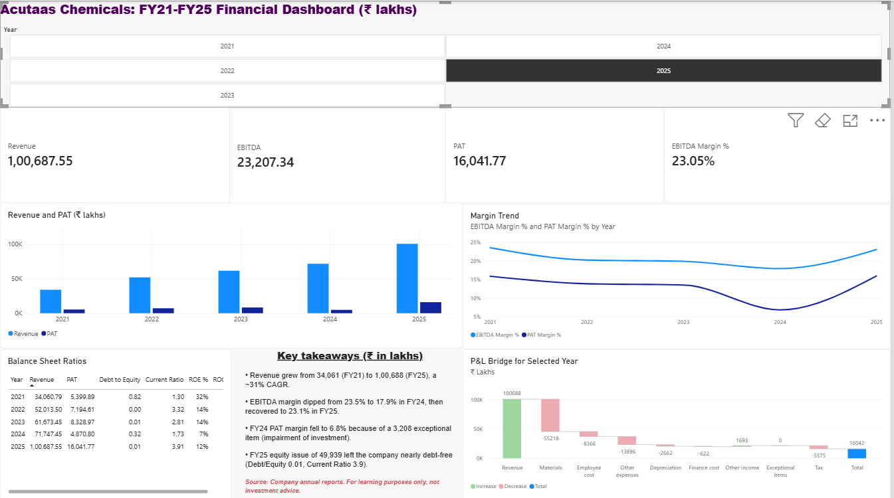
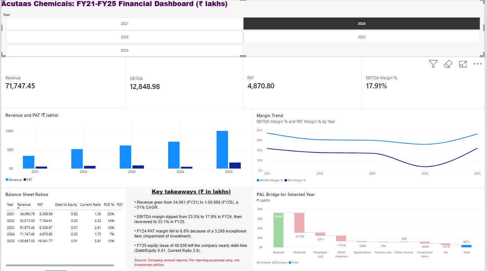

# Acutaas Chemicals: Financial Statement Dashboard (Power BI)

An interactive Power BI dashboard analysing the FY2021–FY2025 financial
statements of Acutaas Chemicals Limited (all figures in ₹ lakhs).

**Built by:** RAJASUNDER.G

## Dashboard preview

**FY2025**

**FY2024** (shows the dip in profit caused by the exceptional item)

## Video demo

[Watch the walkthrough](https://drive.google.com/file/d/1xlrbatA-DdiEmMydixx8CCFSA7pGCWEz/view?usp=sharing)

## What it shows
- KPI cards: Revenue, EBITDA, PAT, EBITDA margin, driven by a year slicer
- Revenue and PAT trend across FY21–FY25
- EBITDA margin and PAT margin trend
- P&L bridge (waterfall): revenue to PAT for the selected year
- Balance sheet ratios: Debt/Equity, Current Ratio, ROE, ROCE
- Key takeaways box

## Data
Income statement, balance sheet and cash flow statement of Acutaas Chemicals
(FY21–FY25), compiled in Excel from the company's published annual reports.
File: `Acutaas_Financials.xlsx`

## How it was built
1. **Power Query:** imported the sheet, split it into three statements,
   cleaned values, added a Section column, and unpivoted the year columns into
   one table (Statement, Section, Line Item, Year, Value).
2. **Model:** a Year dimension table related to the fact table.
3. **DAX measures:** Revenue, EBITDA, PAT, margins, YoY growth, Debt/Equity,
   Current Ratio, ROE, ROCE, and a P&L bridge measure using a helper table.
4. **Visuals:** cards, column and line charts, waterfall, table and slicer,
   with visual interactions set so trend charts always show all years.

## Key insights
- Revenue grew from ₹34,061L to ₹1,00,688L (about 31% CAGR).
- EBITDA margin fell from 23.5% (FY21) to 17.9% (FY24), then recovered to 23.1% in FY25.
- FY24 PAT margin dropped to 6.8% because of a ₹3,208L exceptional item.
- FY25 equity raise of ₹49,939L left the company nearly debt-free
  (Debt/Equity 0.01, Current Ratio 3.9), which also lowered ROE from 32% to 12%.

## Files
- `Acutaas_Dashboard.pbix`: the Power BI dashboard
- `Acutaas_Financials.xlsx`: source data
- `FY2025.png`, `FY2024.png`: dashboard screenshots
- `Acutaas_Dashboard_Demo.mp4`: video walkthrough

## Disclaimer
Built for learning purposes only. This is not investment advice.
